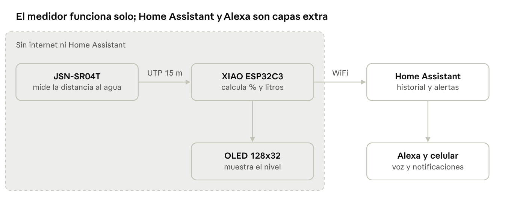

# LEVELS

Medidor del nivel de agua de un tinaco (y, opcionalmente, de la cisterna) con un **Seeed XIAO ESP32C3**, sensores ultrasónicos **JSN-SR04T** y un **OLED SSD1306 128×32**. El firmware es **ESPHome**, así que el nivel se ve en el OLED y también en **Home Assistant**, con alertas en el celular y avisos por **Alexa**.



## Contenido

| Ruta | Qué es |
|---|---|
| [`docs/guia.md`](docs/guia.md) | Guía paso a paso: conexiones, programación, cisterna y solución de problemas |
| [`docs/LEVELS_guia_paso_a_paso.pdf`](docs/LEVELS_guia_paso_a_paso.pdf) | La misma guía en PDF, para imprimir |
| [`docs/pcb_levels.md`](docs/pcb_levels.md) | PCB de planta baja v0.1: lista de materiales, conexiones y fabricación |
| [`firmware/tinaco.yaml`](firmware/tinaco.yaml) | ESPHome, versión de **un sensor** (tinaco) |
| [`firmware/tinaco_cisterna.yaml`](firmware/tinaco_cisterna.yaml) | ESPHome, versión de **dos sensores** (tinaco + cisterna) |
| [`firmware/secrets.example.yaml`](firmware/secrets.example.yaml) | Plantilla de credenciales (WiFi, API, OTA) |

## Inicio rápido

1. Arma el hardware siguiendo la **Parte 1** de la [guía](docs/guia.md).
2. Copia `firmware/secrets.example.yaml` como `firmware/secrets.yaml` y llena tus datos. Ese archivo está en `.gitignore` y no se sube.
3. Compila y carga el firmware:

   ```bash
   pip install esphome
   cd firmware
   esphome run tinaco.yaml          # un sensor
   # esphome run tinaco_cisterna.yaml  # tinaco + cisterna
   ```

4. Calibra `dist_lleno`, `dist_vacio` y `capacidad_l` en `substitutions` (guía, paso 2.8).

Las dos versiones usan el mismo nombre de dispositivo (`tinaco`), así que puedes cambiar de una a otra por OTA sin volver a agregarlo en Home Assistant.

## Hardware

| Pieza | Pines del XIAO |
|---|---|
| Sensor del tinaco (J1) | Trig D2 (GPIO4) · Echo D3 (GPIO5) con divisor 1 kΩ / 2 kΩ |
| Sensor de la cisterna (J2, opcional) | Trig D1 (GPIO3) · Echo D10 (GPIO10) con divisor 1 kΩ / 2 kΩ |
| OLED | SDA D4 (GPIO6) · SCL D5 (GPIO7) · VCC 3V3 |

La alimentación entra por el USB-C del XIAO (cargador de 5 V, 1 A o más). Los sensores se conectan con cable UTP y RJ45 en norma T568B.
