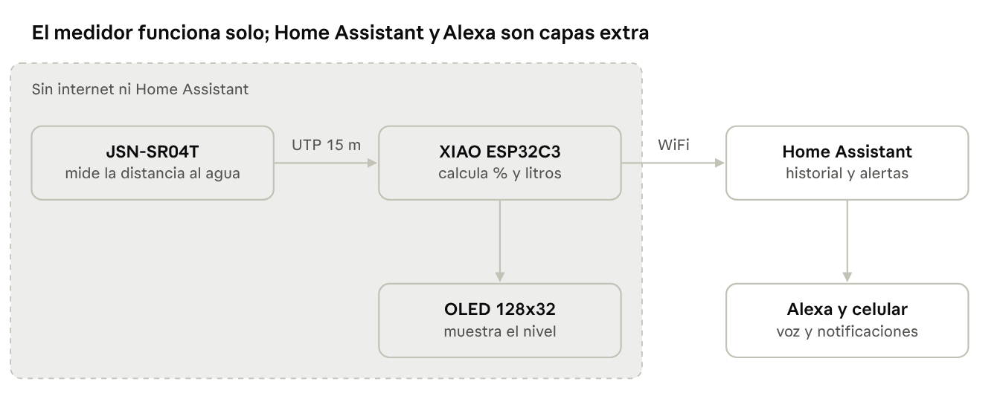
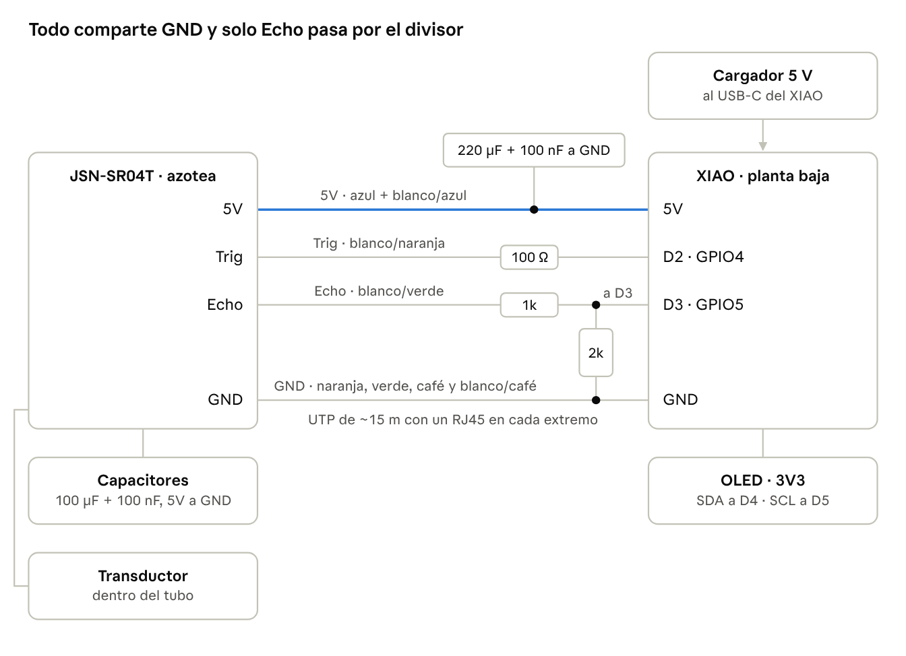

# LEVELS — Guía paso a paso del medidor de tinaco

2026-11-12 · Marco Carrillo

## Qué vamos a construir

El sensor ultrasónico en la azotea mide la distancia hasta el agua; el XIAO en planta baja la convierte en porcentaje y litros, la muestra en el OLED y la envía por WiFi a Home Assistant, que a su vez puede avisarte en el celular y hablar por Alexa.



*Flujo del dato: sensor a Alexa*

La idea clave: **el medidor funciona solo**. El OLED muestra el nivel aunque no tengas Home Assistant. Home Assistant y Alexa son capas que se agregan después, sin tocar el cableado.

El trabajo se divide en dos partes, más una tercera opcional para agregar la cisterna. Hazlas en este orden y no subas nada a la azotea hasta terminar la prueba en mesa (paso 1.9):

1.  **Parte 1 — Conexiones:** armar el hardware, primero en la mesa y luego en el tinaco.

2.  **Parte 2 — Programación:** cargar el firmware, calibrar y conectar con Home Assistant y Alexa.

### Lista de materiales

| Material                                              | Para qué                                                    | Nota                                                    |
|-------------------------------------------------------|-------------------------------------------------------------|---------------------------------------------------------|
| Seeed Studio XIAO ESP32C3                             | El cerebro: lee el sensor, dibuja el OLED, habla por WiFi   | Trae una antenita externa; conéctala siempre            |
| Sensor JSN-SR04T                                      | Mide la distancia al agua                                   | Viene en dos piezas: placa azul + transductor con cable |
| OLED 0.91" 128x32 SSD1306 (I²C)                       | Display local                                               | 4 pines: GND, VCC, SCL, SDA                             |
| Cargador USB de 5 V, 1 A o más + cable USB-C          | Alimentación                                                | Un cargador de celular sirve                            |
| Cable UTP Cat5e, ~16 m                                | Lleva energía y señales a la azotea                         | Que sea de cobre sólido, no "CCA"                       |
| Resistencias de 1 kΩ, 2 kΩ y 100 Ω                    | Divisor del Echo (1 kΩ y 2 kΩ) y protección de Trig (100 Ω) | En lugar de 2 kΩ sirve una de 2.2 kΩ                    |
| Capacitor electrolítico 100 µF, 16 V o más            | Reserva de energía junto al sensor                          | Tiene polaridad                                         |
| Capacitor cerámico 100 nF (marcado "104")             | Filtra ruido rápido                                         | No tiene polaridad                                      |
| Placa perforada pequeña + bornera de 4 o 6 posiciones | Montar el divisor y recibir el UTP                          | Evita empalmes sueltos                                  |
| Caja estanca IP65 chica + prensaestopas               | Proteger la placa azul en la azotea                         |                                                         |
| Tubo PVC sanitario de 4", ~1.6 m + tapón de 4"        | Tubo tranquilizador                                         | Un solo tramo, sin coples                               |
| Silicón, termofit, cinchos                            | Sellos y acabados                                           |                                                         |

**Para la versión con PCB y RJ45, agrega:**

- 2 jacks RJ45 hembra blindados a 90° (uno en la PCB y otro en la placa de la azotea), 2 plugs RJ45 para cable sólido y una ponchadora.

- Del lado del XIAO: 1 capacitor de 220 µF a 10 V o más y 1 cerámico de 100 nF (respaldo de 5V).

- 1 zócalo hembra 1×4 para montar el OLED.

- La lista completa, con referencias (R1, C1…), está en [`pcb_levels.md`](pcb_levels.md).

**Herramientas:** cautín y soldadura, multímetro, pinzas de corte, taladro con broca de 1/2" y una sierra copa del diámetro de tu transductor.

**Del tinaco** (ya los tienes): profundidad 1.40 m, agua llena a 1.20 m del fondo. La capacidad viene en la etiqueta del tinaco; la guía asume 1,100 L.

## Parte 1 — Conexiones

Al terminar esta parte tendrás el sensor, el cable y el XIAO conectados y probados en la mesa, y luego instalados en el tinaco.

### 1.0 Cuatro conceptos antes de soldar

- **Voltaje y GND.** El voltaje siempre se mide entre dos puntos; GND es la referencia, el "cero". Por eso todos los módulos deben compartir el mismo GND: si no, una señal de 5 V en el sensor no significa nada para el XIAO.

- **Alimentación vs. señal.** 5V y GND llevan la energía. Trig y Echo solo llevan información: pulsos que valen 0 o 1.

- **Cómo mide el sensor.** El XIAO le manda a Trig un pulso de 20 µs. El sensor emite un chasquido ultrasónico de 40 kHz y pone Echo en alto hasta que regresa el eco. Lo largo de ese pulso es el tiempo de ida y vuelta: cada 58 µs equivalen a 1 cm.

- **Por qué el divisor de voltaje.** El sensor responde en Echo con 5 V, pero los pines del XIAO aguantan máximo 3.3 V. Un divisor de dos resistencias baja el voltaje en proporción fija: 5 V × 2 kΩ / (1 kΩ + 2 kΩ) = 3.33 V. Sin él, el pin se puede dañar con el tiempo.



*Conexión completa: azotea y planta baja*

Los cuatro hilos de en medio son el UTP, con un RJ45 en cada extremo. La línea de 5V va resaltada porque alimenta todo: la energía entra por el USB-C del XIAO y sube hasta el sensor. Los capacitores van en paralelo, entre 5V y GND, en los dos extremos; ninguna señal pasa por ellos. Junto al XIAO quedan la resistencia de 100 Ω de Trig y el divisor de Echo: 1 kΩ en la línea y, desde el punto medio donde sale el cable a D3, una de 2 kΩ a GND.

### 1.1 Prepara el XIAO

1.  Suelda los pines (headers) que trae el XIAO, o suelda cables directo si irá en placa perforada.

2.  Conecta la antena externa al conector pequeño de la placa (presiónala hasta que haga clic). Sin ella el WiFi apenas llega a un par de metros.

3.  Ubica los pines que vas a usar. El nombre impreso en la placa (D2) y el nombre interno del chip (GPIO4) son el mismo pin; el firmware usa el nombre GPIO.

| Pin en la placa | Nombre en el firmware | Se conecta a                          |
|-----------------|-----------------------|---------------------------------------|
| 5V              | —                     | 5V del sensor (por el UTP)            |
| GND             | —                     | GND de todo                           |
| 3V3             | —                     | VCC del OLED                          |
| D2              | GPIO4                 | Trig del sensor                       |
| D3              | GPIO5                 | Echo del sensor, a través del divisor |
| D4              | GPIO6                 | SDA del OLED                          |
| D5              | GPIO7                 | SCL del OLED                          |

No uses D0, D8 ni D9: son pines de arranque del chip y, si algo los jala al encender, el XIAO puede no iniciar.

### 1.2 Revisa el modo del sensor

Voltea la placa azul del JSN-SR04T y busca el pad marcado **R27** (en la versión 3.0 se llama "mode" o M1/M2). Debe estar **vacío**, sin resistencia ni puente de soldadura. Así el sensor trabaja en modo 1: un pulso en Trig, un pulso de respuesta en Echo, que es lo que espera el firmware. Si tiene algo soldado, quítalo o avísame qué valor tiene.

El transductor (la pieza negra con cable) se conecta a la placa azul con su conector; no lo cortes ni lo alargues.

### 1.3 Asigna los hilos del UTP

El UTP tiene 4 pares trenzados. Cada señal viaja trenzada con un GND: el trenzado hace que el ruido que entra en un hilo se cancele con el de su pareja. La alimentación va en dos hilos para que haya menos caída de voltaje.

| Hilo               | Función | Por qué                             |
|--------------------|---------|-------------------------------------|
| Azul + blanco/azul | 5V      | Dos hilos = la mitad de resistencia |
| Blanco/naranja     | Trig    | Trenzado con su GND (naranja)       |
| Naranja            | GND     | Pareja de Trig                      |
| Blanco/verde       | Echo    | Trenzado con su GND (verde)         |
| Verde              | GND     | Pareja de Echo                      |
| Café + blanco/café | GND     | Refuerzan el retorno                |

Escribe esta tabla en un papel y pégala en la caja: dentro de un año no te vas a acordar.

Corta el UTP a la longitud real del recorrido más 1 m de holgura. Pela unos 3 cm de la funda en cada punta y 5 mm de cada hilo.

**Con conectores RJ45 (recomendado).** En vez de soldar el UTP, pon un jack RJ45 hembra en cada extremo: uno en la placa de la azotea y otro en la PCB de planta baja. El cable lleva un plug ponchado en cada punta, como un cable de red. Si un día hay que acortarlo, solo cortas y ponchas un plug nuevo; las placas no se tocan.

Poncha los dos plugs con la norma **T568B**. Con ella los colores caen exactamente en la asignación de arriba, y cada señal queda en su par trenzado:

| Pin del RJ45 | Color (T568B)  | Función |
|--------------|----------------|---------|
| 1            | Blanco/naranja | Trig    |
| 2            | Naranja        | GND     |
| 3            | Blanco/verde   | Echo    |
| 4            | Azul           | 5V      |
| 5            | Blanco/azul    | 5V      |
| 6            | Verde          | GND     |
| 7            | Blanco/café    | GND     |
| 8            | Café           | GND     |

En cada placa, suelda a los pines del jack: 4 y 5 juntos a 5V; 2, 6, 7 y 8 juntos a GND; 1 a Trig y 3 a Echo. En los pasos 1.4 y 1.5, donde dice "el hilo de tal color", entiende "el pin del jack de ese color".

Tres cuidados:

- **Plugs para cable sólido.** Los de cable flexible no muerden bien el cobre sólido y dan falso contacto. Comprueba el cable con un probador de red antes de instalarlo.

- **La misma norma en las dos puntas.** Si una queda en T568A, Trig y Echo llegan intercambiados y el sensor nunca responde.

- **Marca las dos tomas "NO RED".** Llevan 5 V en los pines 4 y 5. Si alguien las conecta a un router, switch o equipo con PoE, puede dañar ese equipo, o recibir hasta 48 V y quemar el sensor y el XIAO.

### 1.4 Extremo de la azotea: sensor + capacitores

1.  Junta los hilos azul y blanco/azul, tuércelos juntos, estáñalos y suéldalos al pin **5V** de la placa azul.

2.  Junta naranja, verde, café y blanco/café y suéldalos al pin **GND**.

3.  Blanco/naranja al pin **Trig**; blanco/verde al pin **Echo**.

4.  Suelda el **capacitor de 100 µF** entre 5V y GND, lo más cerca posible de la placa. Tiene polaridad: la pata del lado de la franja (−) va a GND. Al revés se infla y puede reventar.

5.  Suelda el **capacitor de 100 nF** también entre 5V y GND, junto al otro. Este no tiene polaridad.

6.  Aísla cada soldadura con termofit.

Por qué los capacitores van arriba: en cada disparo el sensor jala un pico de corriente. Con 15 m de cable de por medio, ese pico llega tarde y el voltaje en la placa cae un instante. Los capacitores son un pequeño tanque de energía pegado al sensor que cubre ese pico.

### 1.5 Extremo de planta baja: divisor y XIAO

Esto va en la PCB de planta baja (o en placa perforada), con el jack RJ45 para recibir el UTP:

1.  **5V:** azul + blanco/azul a una terminal; de ahí un cable al pin **5V** del XIAO.

2.  **GND:** naranja, verde, café y blanco/café a otra terminal; de ahí al **GND** del XIAO.

3.  **Trig:** blanco/naranja a una resistencia de 100 Ω, y de ahí al pin **D2**. El sensor reconoce los 3.3 V del XIAO como un 1; la resistencia suaviza los rebotes de la señal en los 15 m de cable y protege el pin.

4.  **Echo con divisor:**

    1.  Blanco/verde entra a una resistencia de **1 kΩ**.

    2.  El otro extremo de esa resistencia es el "punto medio": de ahí sale un cable al pin **D3**.

    3.  Del mismo punto medio sale una resistencia de 2 kΩ hacia **GND**.

**Ojo: no son tres resistencias seguidas hacia GND.** Son dos tramos que se unen en el punto medio. Arriba va 1 kΩ, entre Echo y el punto medio. Abajo va una de 2 kΩ (2.2 kΩ también sirve), entre el punto medio y GND. El cable a D3 sale de esa unión, y ahí el voltaje queda en 2/3 de los 5 V.

Comprueba el divisor con el multímetro, con todo apagado y antes de conectar el XIAO: entre el blanco/verde y el punto medio deben medirse 1 kΩ, y entre el punto medio y GND, 2 kΩ.

**Capacitores de este lado (C1 y C2 en la PCB).** Un electrolítico de 220 µF (10 V o más) y un cerámico de 100 nF, los dos entre 5V y GND, junto al XIAO. No están en el camino de ninguna señal: son un respaldo de energía donde arranca la línea de 5V. Los indispensables siguen siendo los de la azotea (1.4). El de 220 µF tiene polaridad: la pata de la franja va a GND.

### 1.6 Conecta el OLED

1.  Lee el orden de pines impreso en el OLED. Varía entre fabricantes (GND-VCC-SCL-SDA es el más común, pero hay otros).

2.  **VCC → 3V3** del XIAO (no a 5V). **GND → GND**. **SDA → D4**. **SCL → D5**.

3.  Usa cables cortos, menos de 20 cm. El I²C es un bus pensado para distancias de placa a placa.

### 1.7 Alimentación

Conecta el cargador de 5 V al **USB-C del XIAO**. Es la única entrada de energía: el pin 5V del XIAO está unido directo a su USB-C, y de ahí salen los 5 V hacia el sensor por los pines 4 y 5 del RJ45. El sensor consume menos de 10 mA en reposo y picos breves al disparar, así que cualquier cargador de 1 A sobra.

Como solo hay una entrada, no hace falta diodo ni conector extra. Para programar por cable, desconectas el cargador y conectas la computadora al mismo USB-C. Después de la primera carga todo se actualiza por WiFi, así que casi nunca tendrás que hacerlo.

En la caja deja una abertura para el USB-C y un orificio para el botón de reset del XIAO.

### 1.8 Revisión con multímetro (antes de encender)

1.  **Continuidad:** cada hilo de punta a punta del UTP. Ningún hilo debe tener continuidad con otro.

2.  **Corto entre 5V y GND:** con todo desconectado, no debe pitar.

3.  **Con energía**, en la placa azul de la azotea: entre 5V y GND debes leer 4.8 V o más.

4.  En el pin D3: con el sensor en reposo, cerca de 0 V; nunca más de 3.4 V.

### 1.9 Prueba en mesa

Antes de subir, prueba todo en el piso con el UTP completo enrollado (así pruebas también la distancia).

1.  Haz la Parte 2 hasta el paso 2.5 (cargar el firmware y ver los logs).

2.  Apunta el transductor al piso desde 1 m de altura. El log debe marcar unos 1.00 m, estable a ±1 cm.

3.  Acércalo a menos de 25 cm: verás lecturas raras. Es la zona ciega, y es normal.

4.  Simula el tinaco: un tubo de 1.5 m parado dentro de una cubeta con agua, el sensor arriba. Si aquí lee estable, en el tinaco también.

### 1.10 Arma el tubo tranquilizador

El tubo hace que el sensor mida dentro de una columna de agua quieta: sin olas, sin el flotador ni las paredes del tinaco en el camino del sonido.

1.  **Largo:** 1.40 m (profundidad) + 0.15 m (lo que sobresale arriba de la tapa) − 0.04 m (separación del fondo) = **1.51 m**. Ajusta a tu tinaco real.

2.  **Por qué sobresale 15 cm:** con el tinaco lleno, el agua queda a 20 cm de la tapa, dentro de los ~25 cm de zona ciega. Elevando el sensor 15 cm, la distancia mínima sube a 35 cm.

3.  **Perforaciones de entrada:** 4 a 6 agujeros de 1/2" en los últimos 10 cm de abajo, para que el agua entre y salga.

4.  **Respiradero:** 1 agujero de 1/2" dentro del tinaco, unos 8 cm bajo la tapa (arriba del nivel máximo). Es indispensable: sin él, el aire atrapado bajo el sensor no deja que el agua del tubo suba igual que la de afuera.

5.  **Interior limpio:** lija las rebabas de cortes y agujeros por dentro. Cualquier borde devuelve un eco falso.

6.  **Montaje del sensor:** perfora el tapón de 4" al diámetro del transductor (mídelo; suele estar entre 22 y 25 mm), mételo de modo que quede al ras y apuntando recto hacia abajo, y séllalo con silicón por fuera.

7.  **En el tinaco:** abre en la tapa un agujero de 4", lejos de la entrada de agua y del flotador. Mete el tubo, que quede vertical y aséguralo con una abrazadera o cinchos.

### 1.11 Instalación en la azotea

1.  Monta la caja IP65 junto al tubo y mete la placa azul con sus capacitores. El cable del transductor y el UTP entran por prensaestopas.

2.  Haz un "bucle de goteo" con el UTP antes de que entre a la caja: una curva hacia abajo para que el agua que escurra por el cable gotee ahí y no se meta.

3.  Lleva el UTP protegido del sol (tubo conduit o canaleta). El sol degrada la funda en uno o dos años.

4.  Abajo, el XIAO y el OLED pueden ir en cualquier caja de plástico; solo cuida que la antena no quede pegada a metal.

## Parte 2 — Programación y comunicación

Al terminar esta parte el XIAO tendrá su firmware, el OLED mostrará el nivel, Home Assistant lo verá por WiFi y Alexa podrá decirlo en voz alta.

### 2.0 Las tres piezas de software

- **ESPHome:** en lugar de programar en C++ con Arduino, describes en un archivo YAML *qué* tiene el dispositivo (un sensor ultrasónico en GPIO4/5, un OLED en I²C, WiFi). ESPHome genera el código, lo compila y lo carga al XIAO. El archivo es [`tinaco.yaml`](../firmware/tinaco.yaml), en la carpeta `firmware/` de este repositorio.

- **Home Assistant (HA):** un programa que corre todo el tiempo en una computadora de tu casa. Recibe los datos del XIAO, guarda el historial, hace gráficas, lanza alertas y se conecta con Alexa.

- **La API nativa de ESPHome:** la forma en que el XIAO y HA se hablan dentro de tu red WiFi, cifrada con una clave. No necesita internet ni nube.

La primera carga del firmware es por cable USB. Las siguientes son **OTA** ("over the air"): por WiFi, sin desconectar nada de la pared.

### 2.1 Dónde va a correr Home Assistant

HA necesita una computadora siempre encendida. Opciones, de la más a la menos recomendada para empezar:

| Opción                                                 | Ventaja                                   | Desventaja                              |
|--------------------------------------------------------|-------------------------------------------|-----------------------------------------|
| Raspberry Pi 4 o 5 con Home Assistant OS               | Bajo consumo, es la instalación "oficial" | Hay que comprarla (y una microSD o SSD) |
| Mini PC o laptop vieja con Home Assistant OS           | Reutilizas equipo                         | Consume más luz                         |
| Máquina virtual en una PC que ya esté siempre prendida | Gratis si ya la tienes                    | Más pasos de instalación                |

Instala HA siguiendo la guía oficial para tu equipo en [home-assistant.io/installation](https://www.home-assistant.io/installation/). Al terminar, desde el navegador entras a `http://homeassistant.local:8123` y creas tu usuario.

Si aún no tienes dónde correr HA, no te detiene: haz los pasos 2.2 a 2.7 con la opción B de ESPHome (desde tu PC). El OLED funciona sin HA; después solo agregas el dispositivo.

### 2.2 Instala ESPHome

**Opción A, dentro de Home Assistant (recomendada):** Configuración → Complementos (add-ons) → Tienda → busca **ESPHome Device Builder** → Instalar → activa "Mostrar en la barra lateral" → Iniciar. Aparece un panel ESPHome en el menú de la izquierda.

**Opción B, en tu computadora con Python:**

``` bash
pip install esphome
esphome version
```

Con esta opción trabajas el YAML en tu editor y compilas desde la terminal: `esphome run tinaco.yaml` compila y carga; `esphome logs tinaco.yaml` muestra los logs.

La primera compilación tarda varios minutos porque descarga las herramientas del ESP32-C3; las siguientes son rápidas.

### 2.3 Crea el archivo de secretos

Las contraseñas no van dentro de `tinaco.yaml`, sino en un archivo aparte llamado `secrets.yaml`, para que puedas compartir el YAML sin exponerlas. Donde el YAML dice `!secret wifi_ssid`, ESPHome busca esa clave en `secrets.yaml`.

En el panel de ESPHome: menú de los tres puntos (arriba a la derecha) → **Secrets**. En la opción B, crea el archivo junto a `tinaco.yaml`.

``` yaml
wifi_ssid: "NombreDeTuRed"
wifi_password: "ContrasenaDeTuRed"
api_key: "PEGA_AQUI_UNA_CLAVE_DE_32_BYTES_EN_BASE64="
ota_password: "una-contrasena-larga-cualquiera"
```

- **WiFi:** el ESP32-C3 solo se conecta a redes de **2.4 GHz**. Si tu módem tiene una sola red combinada 2.4/5 GHz suele funcionar; si tiene dos nombres, usa el de 2.4.

- **api_key:** genérala con `openssl rand -base64 32` en una terminal, o cópiala de la página de la API en la documentación de ESPHome, que genera una al cargarla.

- **ota_password:** cualquier texto largo; protege que nadie más en tu red cargue firmware al XIAO.

### 2.4 Crea el dispositivo y pega el YAML

1.  En el panel de ESPHome: **+ New device** → Continue → nombre `tinaco` → tipo **ESP32-C3** → Next. Si te muestra una clave de cifrado, cópiala; puedes usarla como `api_key`.

2.  Cuando aparezca la tarjeta "tinaco", pulsa **Edit**.

3.  Borra el contenido y pega todo `tinaco.yaml`.

4.  Ajusta los tres valores de `substitutions` (se explican en 2.8). Para la prueba en mesa déjalos como están.

5.  Pulsa **Save** y luego **Validate**: debe decir que la configuración es válida. Si marca un error, señala la línea; lo más común es la sangría (YAML usa espacios, nunca tabuladores).

### 2.5 Primera carga por USB

1.  Conecta el XIAO a tu computadora con el cable USB-C (de datos, no solo de carga). Desconecta el cargador.

2.  En la tarjeta "tinaco": **Install**.

3.  Elige según tu caso:

    1.  **Plug into this computer:** carga directo desde el navegador (Chrome o Edge). Solo funciona si entras a HA por HTTPS.

    2.  Si no tienes HTTPS: **Manual download** → formato **Factory** → se descarga un `.bin`. Abre [web.esphome.io](https://web.esphome.io) en Chrome o Edge → Connect → elige el puerto del XIAO → Install → selecciona el `.bin`.

    3.  Opción B: `esphome run tinaco.yaml` y elige el puerto USB cuando te pregunte.

4.  Si la computadora no detecta el XIAO: desconecta el cable, mantén presionado el botón **B** (BOOT) de la placa, conecta el cable y suelta el botón. Así entra en modo de carga.

5.  Al terminar, el XIAO se reinicia y abre la ventana de **logs**. Busca estas líneas, en este orden:

    1.  `WiFi Connected` con una dirección IP: ya está en tu red.

    2.  `'Distancia al agua': Sending state 1.003 m`: el sensor responde.

    3.  `'Nivel': Sending state ...`: el cálculo funciona.

6.  Si el WiFi no conecta en 1 minuto, el XIAO crea su propia red llamada **"Tinaco Fallback"**. Conéctate a ella desde el celular y te abrirá una página para elegir tu red y escribir la contraseña.

Desde aquí todas las cargas son por WiFi: **Install → Wirelessly**.

### 2.6 Agrega el XIAO a Home Assistant

1.  Con el XIAO encendido y en la red, ve a **Configuración → Dispositivos y servicios**. Debe aparecer "Descubierto: tinaco".

2.  **Configurar** → pega la `api_key` si la pide → asigna un área ("Azotea").

3.  El dispositivo trae estas entidades: **Distancia al agua**, **Nivel**, **Litros**, **Señal WiFi** y el botón **Reiniciar**. Sus nombres internos serán parecidos a `sensor.tinaco_nivel`; confírmalos en la pestaña Entidades, porque los usarás en 2.9 y 2.10.

4.  Agrega una tarjeta **Indicador** (gauge) al tablero con `sensor.tinaco_nivel`, y una **Gráfica de historial** con `sensor.tinaco_litros` para ver el consumo del día.

### 2.7 Qué hace cada bloque de tinaco.yaml

| Bloque                    | Qué hace                                                                                  | Cuándo lo tocarías     |
|---------------------------|-------------------------------------------------------------------------------------------|------------------------|
| `substitutions`           | Variables: distancias de calibración y capacidad. Se reemplazan donde aparece `${nombre}` | Al calibrar (2.8)      |
| `esphome` + `esp32`       | Nombre del dispositivo y tipo de placa (`seeed_xiao_esp32c3`)                             | Nunca                  |
| `logger`                  | Activa los mensajes que ves en los logs                                                   | Nunca                  |
| `api`                     | La conexión cifrada con Home Assistant                                                    | Nunca                  |
| `ota`                     | Permite cargar firmware por WiFi, con contraseña                                          | Nunca                  |
| `wifi` + `captive_portal` | Tu red, y la red de respaldo "Tinaco Fallback" si falla                                   | Si cambias de módem    |
| `i2c`                     | El bus del OLED: SDA en GPIO6 (D4), SCL en GPIO7 (D5)                                     | Nunca                  |
| `sensor: ultrasonic`      | Dispara el sensor cada 2 s y convierte el pulso de Echo en metros                         | Ver abajo              |
| `sensor: template` Nivel  | Convierte la distancia en %, cada 10 s                                                    | Nunca                  |
| `sensor: template` Litros | Convierte el % en litros, cada 10 s                                                       | Nunca                  |
| `wifi_signal`             | Qué tan fuerte llega el WiFi (en dBm)                                                     | Nunca                  |
| `button: restart`         | Botón en HA para reiniciar el XIAO a distancia                                            | Nunca                  |
| `font` + `display`        | Las letras y el dibujo del OLED: % grande, barra y litros                                 | Si quieres otro diseño |

**El sensor ultrasónico, línea por línea:**

- `trigger_pin: GPIO4` y `echo_pin: GPIO5`: los pines D2 y D3.

- `pulse_time: 20us`: duración del pulso de disparo. El JSN-SR04T pide al menos 10 µs; 20 da margen.

- `timeout: 4m`: si no hay eco dentro de lo que tardaría el sonido en ir y volver de 4 m, la lectura se descarta.

- `filters`, que es donde se resuelven las lecturas erróneas que te preocupaban:

  - `filter_out: nan` tira las lecturas fallidas.

  - `median` junta las últimas 9 lecturas, las ordena y se queda con la del medio. Si 2 o 3 salieron locas por una gota o un rebote, quedan en los extremos y nunca se publican. Con `send_every: 5`, publica un valor cada 5 lecturas (unos 10 s).

**El cálculo del nivel:** `% = (dist_vacio − distancia) / (dist_vacio − dist_lleno) × 100`. Ejemplo: con 0.35 y 1.55, si el sensor lee 0.95 m: (1.55 − 0.95) / (1.55 − 0.35) × 100 = 50 %. Después se limita entre 0 y 100 para que una lectura un poco fuera de rango no muestre 103 %.

### 2.8 Calibra con el tinaco real

Con el tubo y el sensor ya instalados:

1.  **dist_lleno:** espera a que el tinaco se llene y el flotador corte. Lee en HA (o en los logs) el valor de **Distancia al agua**. Ese número es `dist_lleno` (debería andar cerca de 0.35 m).

2.  **dist_vacio:** no hace falta vaciar el tinaco. Es `dist_lleno` + la altura que hay entre el agua llena y la salida del tinaco (el multiconector): 0.35 + (1.20 − 0.08) = **1.47 m**. En el ejemplo la salida está a 8 cm del fondo; mide la de tu tinaco por fuera, del fondo a la salida. Así 0 % significa "ya no sale agua": lo que queda abajo es el fondo de sedimentos, que no se puede usar y que de paso le da peso al tinaco. Tus alertas (25 %, 10 %) quedan sobre agua que sí puedes usar.

3.  **capacidad_l:** no uses la de la etiqueta. Esa es la capacidad nominal hasta el borde, e incluye el fondo que no sale. Calcula los litros útiles, los que hay entre dist_lleno y dist_vacio, con el procedimiento de abajo.

4.  Edita los tres valores en `substitutions`, Save, **Install → Wirelessly**.

**Cómo calcular `capacidad_l`.** Se calcula una vez, a mano, y se escribe fija en el YAML.

1.  Mide la circunferencia del tinaco con una cinta métrica, a media altura. Es más fácil y más exacto que medir el diámetro por encima.

2.  Diámetro exterior = circunferencia ÷ π. Réstale dos veces el grosor de la pared (se mide asomándote por la tapa) para obtener el diámetro interior.

3.  Altura útil = `dist_vacio` − `dist_lleno`, en metros.

4.  Litros útiles = π × (diámetro interior ÷ 2)² × altura útil × 1000.

Ejemplo con medidas inventadas: circunferencia de 3.46 m → diámetro exterior de 1.101 m; con pared de 5 mm, el interior es 1.091 m y el radio 0.5457 m. Altura útil: 1.47 − 0.35 = 1.12 m. Litros: 3.1416 × 0.5457² × 1.12 × 1000 ≈ **1,048 L**, en vez de los 1,100 de la etiqueta.

Esto supone que la pared es recta. Mide la circunferencia en tres alturas (arriba, en medio y abajo): si difieren más de 2 o 3 cm, el tinaco es cónico y conviene otro cálculo.

Esto funciona porque un tinaco vertical tiene el mismo diámetro de arriba abajo: cada centímetro de altura son los mismos litros.

### 2.9 Alertas en el celular

1.  Instala la app **Home Assistant** en tu celular e inicia sesión. Eso crea un servicio de notificación con un nombre parecido a `notify.mobile_app_<tu_telefono>`.

2.  En HA: **Configuración → Automatizaciones → Crear**. Se puede hacer con clics, o en el modo YAML (tres puntos → Editar en YAML) pegar esto:

``` yaml
alias: Tinaco bajo
triggers:
  - trigger: numeric_state
    entity_id: sensor.tinaco_nivel
    below: 20
    for: "00:10:00"
actions:
  - action: notify.mobile_app_tu_telefono
    data:
      title: Tinaco bajo
      message: "El tinaco está al {{ states('sensor.tinaco_nivel') | int }} %."
```

El `for: 10 minutos` evita que te avise por un instante en que una lectura bajó. Cambia `tu_telefono` por el nombre real del servicio.

Otras alertas útiles con la misma estructura: el nivel no subió en 12 horas (falló el agua de la red o el flotador), o el nivel bajó de madrugada sin que nadie use agua (posible fuga).

### 2.10 Conectar con Alexa

Alexa no sabe leer un sensor de porcentaje, así que no basta con preguntarle. El truco: un **script** de HA que hace hablar a tu Echo, y una **rutina** de Alexa que lo dispara con la frase que tú elijas.

Necesitas dos conexiones:

1.  **Que Alexa vea HA**, para disparar el script. La forma fácil es **Home Assistant Cloud** (suscripción mensual de Nabu Casa): Configuración → Home Assistant Cloud → activar Alexa → en la app de Alexa, activar la skill de Home Assistant. Hay una forma gratuita, con una skill propia en Amazon Developer y AWS, pero es larga y delicada; déjala para cuando todo lo demás funcione.

2.  **Que HA pueda hablar por el Echo.** Se usa la integración comunitaria **Alexa Media Player**, que se instala desde HACS (la tienda comunitaria de HA). Crea servicios como `notify.alexa_media_echo_sala`.

El script (Configuración → Scripts → Crear → modo YAML):

``` yaml
alias: Anunciar nivel del tinaco
sequence:
  - action: notify.alexa_media_echo_sala
    data:
      message: >-
        El tinaco está al {{ states('sensor.tinaco_nivel') | int }} por ciento,
        unos {{ states('sensor.tinaco_litros') | int }} litros.
      data:
        type: tts
```

Luego:

1.  En HA, **expón** el script a Alexa (Configuración → Asistentes de voz → Exponer). En Alexa, los scripts aparecen como **escenas**.

2.  En la app de Alexa: **Más → Rutinas → +**. Cuando: *Voz* → "cuánto tiene el tinaco". Acción: *Hogar inteligente* → la escena "Anunciar nivel del tinaco".

3.  Prueba: "Alexa, ¿cuánto tiene el tinaco?"

También puedes llamar el mismo servicio de Alexa desde la automatización de 2.9, para que el Echo avise en voz alta cuando el tinaco esté bajo.

Home Assistant Cloud, Alexa Media Player y los menús de Alexa cambian con frecuencia. Si un nombre de menú no coincide, revisa la documentación actual de cada uno; la idea general (script + escena + rutina) se mantiene.

## Parte 3 — Agregar la cisterna

La misma PCB y el mismo XIAO leen un segundo sensor en la cisterna. Hay que soldar los componentes que se dejaron vacíos, tender un segundo UTP de unos 4 m y cambiar el firmware a `tinaco_cisterna.yaml`. Ese archivo vive aparte de `tinaco.yaml`, en [`firmware/`](../firmware/tinaco_cisterna.yaml): para volver a un solo sensor, solo cargas el otro.

Haz esta parte cuando el tinaco ya funcione completo (Partes 1 y 2). Así, si algo falla, sabes que el problema está en lo nuevo.

### 3.1 Qué se suelda en la PCB

| Ref     | Componente             | Para qué                         |
|---------|------------------------|----------------------------------|
| J2      | Jack RJ45 blindado 90° | Entrada del cable de la cisterna |
| R6      | 100 Ω                  | Serie en Trig de la cisterna     |
| R3      | 1 kΩ                   | Divisor de Echo, tramo de arriba |
| R4      | 2 kΩ (o 2.2 kΩ)        | Divisor de Echo, tramo de abajo  |
| C3 + C4 | 220 µF y 100 nF        | Respaldo de 5V; opcionales       |

Con eso, la cisterna queda en estos pines:

| Señal               | Pin del XIAO              | Pasa por                             |
|---------------------|---------------------------|--------------------------------------|
| Trig de la cisterna | D1 (GPIO3)                | R6 → J2 pin 1                        |
| Echo de la cisterna | D10 (GPIO10)              | Divisor R3/R4 ← J2 pin 3             |
| 5V y GND            | Compartidos con el tinaco | J2 pines 4-5 (5V) y 2, 6, 7, 8 (GND) |

El divisor es igual al del tinaco: depende del voltaje del sensor (5 V), no del largo del cable.

### 3.2 Prepara el sensor de la cisterna

1.  Tu segundo sensor es un **JSN-SR04T-V3.3**. Revisa el pad de modo de la placa (en las versiones 3.x se marca "mode" o M1/M2): debe estar **vacío**, igual que en 1.2.

2.  Arma el extremo del sensor igual que en 1.4: jack RJ45 en norma T568B, y los capacitores de 100 µF y 100 nF entre 5V y GND junto a la placa.

3.  Poncha el UTP de ~4 m con T568B en las dos puntas y pruébalo con el probador de red.

4.  Prueba en mesa (como en 1.9): con el firmware de dos sensores cargado, el renglón "C" del OLED debe mostrar lectura al apuntar el sensor al piso.

### 3.3 Instalación en la cisterna

La cisterna es más difícil que el tinaco por dos razones: la humedad es casi constante, y hay más movimiento de agua.

1.  **Humedad.** Dentro de la cisterna solo debe ir el transductor. La caja con la placa azul, de ser posible, va afuera, junto al registro. Usa prensaestopas y bucle de goteo en el cable, igual que en la azotea.

2.  **Tubo tranquilizador.** También hace falta, o más: la entrada de agua de la red cae con fuerza y la succión de la bomba hace remolinos. Mismas reglas que en 1.10: un solo tramo, agujeros abajo, respiradero arriba del nivel máximo e interior sin rebabas.

3.  **Largo del tubo:** 1.20 m (altura) + 0.15 m (sobre la tapa) − 0.04 m (separación del fondo) = **1.31 m**. Ajusta a tu cisterna real.

4.  **Ubicación:** lejos de la entrada de agua y de la pichancha de la bomba.

5.  Si la tapa queda a nivel de piso, protege el tramo que sobresale para que nadie lo pise ni lo golpee.

### 3.4 Cambia el firmware

1.  En el panel de ESPHome, abre el dispositivo **tinaco** con **Edit**.

2.  Reemplaza el contenido por `tinaco_cisterna.yaml`. Los secretos (`secrets.yaml`) no cambian.

3.  Save → **Install → Wirelessly**. El nombre del dispositivo sigue siendo `tinaco`, así que la carga por WiFi lo encuentra igual.

4.  El OLED cambia a dos renglones: **T** (tinaco) arriba y **C** (cisterna) abajo, cada uno con su % y su barra. Ya no muestra litros, porque no caben.

5.  **En Home Assistant cambian los nombres.** "Nivel" pasa a ser "Tinaco nivel" y aparecen "Cisterna distancia", "Cisterna nivel" y "Cisterna litros". Las entidades viejas quedan como "no disponibles": bórralas y actualiza la automatización de 2.9 y el script de Alexa de 2.10 con los nombres nuevos que veas en la pestaña Entidades.

### 3.5 Calibra la cisterna

La idea es la misma que en 2.8, con una diferencia importante: el 0 % de la cisterna no es la salida, sino la **succión de la bomba** (la pichancha). Por debajo de ese nivel la bomba chupa aire.

1.  **cis_lleno:** con la cisterna llena (cuando su flotador corta), lee "Cisterna distancia". Debería andar cerca de 0.35 m.

2.  **cis_vacio:** `cis_lleno` + (1.00 − altura de la pichancha sobre el fondo). Ejemplo: con la pichancha a 10 cm, 0.35 + (1.00 − 0.10) = 1.25 m.

3.  **cis_capacidad_l:** los litros útiles entre `cis_lleno` y `cis_vacio`. El valor que trae el YAML (920 L) es provisional. Tienes dos formas de calcularlo:

    1.  **Con el diámetro interior**, con la fórmula de 2.8. Si la cisterna está enterrada y no puedes medir la circunferencia por fuera, mide el diámetro por dentro con una regla rígida a través del registro.

    2.  **Con el propio tinaco** (no necesitas medir nada): cuando la bomba suba agua al tinaco, sin que entre agua de la calle a la cisterna, los litros que ganó el tinaco son los que perdió la cisterna. Litros por metro de cisterna = litros que subió el tinaco ÷ metros que bajó la cisterna. Multiplícalo por (`cis_vacio` − `cis_lleno`) y tienes `cis_capacidad_l`. Repite 2 o 3 veces y promedia.

4.  Edita los valores en `substitutions` de `tinaco_cisterna.yaml` y carga por WiFi.

### 3.6 Alertas con dos tanques

Con los dos niveles a la vista, las alertas útiles cambian:

| Condición                                 | Qué significa                                           |
|-------------------------------------------|---------------------------------------------------------|
| Cisterna por debajo de 20 %               | No enciendas la bomba: puede trabajar en seco y dañarse |
| Tinaco bajo y cisterna con agua           | Hay que bombear                                         |
| La cisterna no sube en 12 horas           | No está llegando agua de la red                         |
| La cisterna baja sin que la bomba trabaje | Posible fuga en la cisterna                             |

Se arman igual que la automatización de 2.9, cambiando la entidad y el umbral. Para Alexa, el mensaje del script de 2.10 puede incluir los dos tanques:

``` yaml
message: >-
  El tinaco está al {{ states('sensor.tinaco_nivel') | int }} por ciento
  y la cisterna al {{ states('sensor.cisterna_nivel') | int }} por ciento.
```

Cambia `sensor.tinaco_nivel` y `sensor.cisterna_nivel` por los nombres que aparezcan en tu pestaña Entidades.

## Solución de problemas

Casi todas las fallas se encuentran revisando, en orden, los logs de ESPHome y el multímetro.

| Síntoma                                        | Causa probable                                                                    | Qué revisar                                                                                          |
|------------------------------------------------|-----------------------------------------------------------------------------------|------------------------------------------------------------------------------------------------------|
| La computadora no ve el XIAO                   | Cable USB solo de carga, o el XIAO no está en modo de carga                       | Otro cable; BOOT presionado al conectar (2.5, paso 4)                                                |
| No conecta al WiFi                             | Red de 5 GHz, contraseña mal escrita o antena desconectada                        | Red de 2.4 GHz; `secrets.yaml`; la antena en su conector                                             |
| "Distancia al agua" siempre vacía (sin valor)  | No llega el eco: Trig o Echo invertidos, sensor sin 5 V o pad R27 con resistencia | Colores del UTP (1.3); 4.8 V o más en la placa azul (1.8); R27 vacío (1.2)                           |
| Lecturas que saltan mucho                      | Olas, flotador o paredes en el camino del sonido; condensación en el transductor  | Que el sensor mida dentro del tubo; respiradero del tubo (1.10, paso 4)                              |
| Con el tinaco lleno marca un valor raro o fijo | El agua está dentro de la zona ciega (menos de 25 cm)                             | Que el sensor sobresalga 15 cm sobre la tapa (1.10, paso 2)                                          |
| El % no cambia aunque el agua sí               | Aire atrapado en el tubo                                                          | El respiradero existe y no está tapado                                                               |
| Marca 0 % o 100 % siempre                      | Calibración al revés o con valores equivocados                                    | `dist_lleno` menor que `dist_vacio` (2.8)                                                            |
| OLED apagado                                   | VCC y GND invertidos, SDA y SCL cruzados o dirección distinta                     | Orden de pines (1.6); el log debe mostrar el dispositivo en 0x3C; algunos usan 0x3D                  |
| El XIAO se reinicia solo                       | Cargador débil o falso contacto en 5 V                                            | Otro cargador; soldaduras de la bornera                                                              |
| HA no descubre el dispositivo                  | HA y el XIAO en redes distintas (red de invitados, repetidor aislado)             | Que ambos estén en la misma red local; agregarlo a mano en Dispositivos → ESPHome con la IP del XIAO |
